# ConsumerVoice: System Architecture Specification

## 1. High-Level Architecture Overview

**ConsumerVoice** is an enterprise-grade NLP and feedback intelligence platform engineered to analyze unstructured e-commerce reviews, classify fine-grained product defects, explain model predictions using feature attribution, and verify AI-generated customer responses against source evidence to eliminate hallucinations.

```mermaid
flowchart TD
    subgraph DataLayer["Data & Persistence Layer"]
        RawCSV["Raw Dataset<br/>Flipkart Reviews (205,052 rows)"]
        AuditEngine["Data Preprocessing & Audit<br/>(Leakage-Safe Deduplication & Quarantine)"]
        Splits["Stratified Splits (80/10/10)<br/>Train (73k), Val (9k), Test (9k)"]
        SQLiteDB[("SQLite Database<br/>(consumervoice.db)")]
    end

    subgraph NlpLayer["AI / NLP Modeling Layer"]
        BaselineModel["Model A: TF-IDF + Balanced LogReg<br/>(Macro F1: 0.6925 | Latency: 0.008ms)"]
        DistilBERT["Model B: DistilBERT Sequence Classifier<br/>(Google Colab GPU / T4 Fine-Tuning)"]
        XaiEngine["ModelExplainer<br/>(Linear Feature Attribution: TF-IDF × Coefficients)"]
        IssueEngine["IssueDetector<br/>(10 Taxonomy Categories + Negation Awareness)"]
        Summarizer["SummarizationService<br/>(TF-IDF Extractive + Citation Retention)"]
        ResponseEngine["ResponseGenerator<br/>(Grounded Safe Response Synthesis)"]
        FactVerifier["HallucinationDetector<br/>(Atomic Claim Extraction + Evidence Verification)"]
    end

    subgraph ApiLayer["FastAPI Application Layer (:8000)"]
        FastAPIApp["FastAPI REST Engine"]
        RoutesReview["/api/reviews (Search, Pagination, Detail)"]
        RoutesAnalyze["/api/reviews/analyze (Multi-Task Real-Time NLP)"]
        RoutesDash["/api/dashboard (Overview, Sentiment, Issues)"]
        RoutesSummary["/api/summaries/generate (Citation Summarization)"]
        RoutesResponse["/api/responses/generate & /verify (Claim Verification)"]
        RoutesEval["/api/evaluations (Model Benchmarks & Switching)"]
        RoutesQuality["/api/dataset/quality (Hygiene Audit)"]
    end

    subgraph UiLayer["Frontend Presentation Layer (:5173)"]
        ReactApp["React 18 + Vite + Tailwind CSS"]
        PageDash["Overview Dashboard"]
        PageExplorer["Review Corpus Explorer"]
        PageAnalyze["AI Review Analysis Studio"]
        PageSummary["Summarization Studio"]
        PageResponse["AI Response Generator"]
        PageHallucination["Hallucination Evaluation Lab"]
        PageModels["Model Lab & Evaluation"]
        PageHealth["Dataset Health Audit"]
        PageMethodology["Methodology & Docs"]
    end

    RawCSV --> AuditEngine
    AuditEngine --> Splits
    AuditEngine --> SQLiteDB
    Splits --> BaselineModel
    Splits --> DistilBERT

    BaselineModel --> XaiEngine
    BaselineModel --> FastApiApp
    XaiEngine --> FastApiApp
    IssueEngine --> FastApiApp
    Summarizer --> FastApiApp
    ResponseEngine --> FastApiApp
    FactVerifier --> FastApiApp
    SQLiteDB <--> FastApiApp

    FastAPIApp --> RoutesReview
    FastAPIApp --> RoutesAnalyze
    FastAPIApp --> RoutesDash
    FastAPIApp --> RoutesSummary
    FastAPIApp --> RoutesResponse
    FastAPIApp --> RoutesEval
    FastAPIApp --> RoutesQuality

    RoutesReview <--> PageExplorer
    RoutesAnalyze <--> PageAnalyze
    RoutesDash <--> PageDash
    RoutesSummary <--> PageSummary
    RoutesResponse <--> PageResponse
    RoutesResponse <--> PageHallucination
    RoutesEval <--> PageModels
    RoutesQuality <--> PageHealth
```

---

## 2. Layer-by-Layer Architectural Details

### 2.1 Data & Persistence Layer
- **Raw Input**: `data/raw/Dataset-SA.csv` containing 205,052 customer reviews from Flipkart across 6 fields.
- **Preprocessing & Audit Service (`data_preprocessing.py`)**:
  - Detects and drops exact duplicate rows for benchmarking.
  - Recalculates missing text fields and parses numeric ratings.
  - Isolates ambiguous text groups (966 groups, 82,754 rows with identical text but conflicting labels) into `data/processed/ambiguous_labels.csv`.
  - Generates independent, non-leaking stratified 80/10/10 splits (`sentiment_train.csv`, `sentiment_validation.csv`, `sentiment_test.csv`).
- **Database Engine**: Local SQLite database (`backend/consumervoice.db`) with SQLAlchemy ORM models:
  - `reviews`, `sentiment_predictions`, `issue_detections`, `generated_summaries`, `generated_responses`, `verification_results`, `issue_annotations`.

### 2.2 Machine Learning & NLP Service Layer
1. **Primary Sentiment Classifier (`sentiment_baseline.joblib`)**:
   - `TfidfVectorizer` (40,000 unigrams/bigrams, sublinear TF scaling, custom negation-preserving stop words).
   - `LogisticRegression` (`class_weight='balanced'`, L-BFGS solver, seed 42).
   - Tested on untouched test set: **Macro F1: 0.6925**, **Accuracy: 0.8483**, **Latency: 0.008 ms/sample**.
2. **Transformer Fine-Tuning Pipeline (`scripts/train_transformer.py` & Colab Notebook)**:
   - Hugging Face `AutoModelForSequenceClassification` on `distilbert-base-uncased` with 3-class classification head (0: Negative, 1: Neutral, 2: Positive).
   - Designed for Google Colab GPU training with early stopping and validation checkpointing.
3. **Explainable AI (`explainability.py`)**:
   - Computes exact local word attributions: $\text{Score}(w_i, k) = x_i \times \beta_{k, i}$.
   - Extracts top supporting and opposing features and generates human-readable narrative explanations.
4. **Contextual Issue Detection (`issue_detection.py`)**:
   - Multi-label rule matcher spanning 10 taxonomy categories with contextual negation suppression.
5. **Summarization Engine (`summarization.py`)**:
   - Extractive TF-IDF sentence centroid ranking with strict review ID citation retention.
   - Optional Gemini abstractive mode using the official `google-genai` SDK.
6. **Grounded Response Generator (`response_generation.py`)**:
   - Synthesizes professional support responses with anti-hallucination guardrails prohibiting fabricated refunds or replacement dates.
7. **Hallucination Detector (`hallucination_detector.py`)**:
   - Decomposes responses into atomic claims.
   - Filters non-factual courtesy statements.
   - Compares claims against customer feedback and corporate policies.
   - Classifies claims into `SUPPORTED`, `CONTRADICTED`, or `UNSUPPORTED`.

### 2.3 Backend API Layer (FastAPI)
- Modular REST API structured in `backend/app/api/routes/`.
- Full OpenAPI / Swagger documentation at `/docs`.
- Pydantic v2 data validation schemas.
- In-memory service caching for instant sub-millisecond inference.

### 2.4 Frontend Presentation Layer (React + Vite)
- Built with React 18, Vite 6, Tailwind CSS, Lucide React, and Recharts.
- 9 dedicated pages with dark navy SaaS styling:
  1. Overview Dashboard
  2. Review Explorer
  3. AI Review Analysis Studio
  4. Summarization Studio
  5. AI Response Generator
  6. Hallucination Evaluation Lab
  7. Model Lab & Evaluation
  8. Dataset Health Audit
  9. Methodology & Documentation

